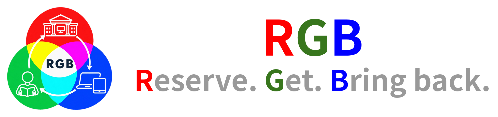
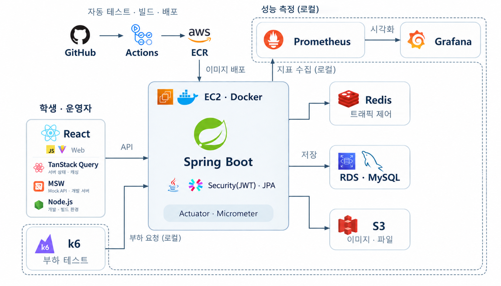

### 학생 · 운영자 · 기자재를 연결하는 통합 대여 관리 서비스

2026학년도 홍익대학교 컴퓨터공학과 졸업프로젝트

 

## 프로젝트 소개

컴퓨터공학과 멀티미디어실은 학생들에게 노트북, 태블릿, 보조배터리, 키보드·마우스, 독서대 등 기자재를 대여합니다. 그동안 대여 업무는 공지사항, 구글폼, 수기 약정서, 엑셀로 흩어져 있었고, **같은 정보가 두 번 기록**되었습니다. 학생이 약정서를 손으로 쓰면, 근로생이 그 내용을 다시 엑셀에 옮겨 적는 방식이었습니다.

| | 기존 대여 과정의 문제 |
| --- | --- |
| **학생** | 어떤 종류의 기자재를 빌릴 수 있는지 알기 어려움 모델별 실시간 재고를 확인할 수 없음 사전신청에서도 원하는 모델을 고르기 어려움 상시대여 재고는 직접 방문해야 확인 가능 |
| **운영자** | 수기 약정서를 엑셀에 다시 입력 글씨 판독 문제, 오타·누락으로 인한 오류 기록이 공지·구글폼·장부·엑셀에 분산 학기 초 업무 폭증과 중복 배정 위험 |

**RGB**는 조회부터 신청, 승인, 수령, 반납까지 하나의 웹 서비스에서 처리하는 통합 대여 관리 시스템입니다. 학생은 기자재 종류와 모델별 재고를 보고 원하는 모델을 직접 선택하고, 운영자는 신청·기기·회원을 하나의 데이터로 관리합니다. 학과는 쌓인 대여 데이터를 구매와 운영 정책에 활용할 수 있습니다.

이름은 빛의 삼원색처럼 $\color{#FF0000}\textbf{Reserve}$ · $\color{#38761D}\textbf{Get}$ · $\color{#0000FF}\textbf{Bring back}$ 흐름과 학과·학생·기자재가 조화를 이루어, 예산으로 마련한 기자재가 방치되지 않고 순환되도록 하자는 뜻에서 지었습니다.

### 프로젝트 목표

- 멀티미디어실 기자재 대여 업무의 통합 관리
- 기자재 대여 가능 여부를 실시간으로 제공
- 대여 신청·승인·수령·반납 과정의 체계화
- 운영자(근로생·조교)의 반복 관리 업무 감소
- 실제 학과 내부 서비스로 확장할 수 있는 구조 설계

 

## 대여 흐름

| 단계 | 학생 | 운영자 | 서버 |
| --- | --- | --- | --- |
| $\color{#FF0000}\textbf{Reserve}$ | 모델과 재고를 보고 수령 희망일·대여 사유를 적어 신청 | 조교가 신청을 승인 또는 반려 | 신청 기간·계정 상태·중복 대여 규칙을 검사하고, 기기 1대를 즉시 배정해 다른 신청에 배정되지 않도록 잡아 둠 |
| $\color{#38761D}\textbf{Get}$ | 수령 기한 안에 멀티미디어실 방문 | 학생증 확인 후 기기 사진과 함께 수령 처리 | 수령 기한이 지나면 노쇼로 처리하고 기기를 다시 대여 가능 상태로 되돌림 |
| $\color{#0000FF}\textbf{Bring back}$ | 기자재 반납 | 기기 사진과 함께 반납 처리 | 반납된 기기를 즉시 대여 가능 재고에 반영하고 대여 기록에 남김 |

 

## 주요 기능

- **회원** : 회원가입·로그인, 이메일 인증번호를 통한 비밀번호 재설정, 마이페이지와 프로필 사진
- **기자재 조회·신청** : 카테고리·모델별 재고 조회, 찜한 기자재를 대시보드에서 바로 신청, 내 대여 내역과 상태 확인
- **대여 운영** : 신청 승인·반려, 수령·반납 처리와 기기 사진 기록, 전체 대여 기록 조회
- **기자재 관리** : 카테고리·모델 등록, 라벨번호 접두사와 수량으로 기기 일괄 등록(중복 번호 등록 방지), 개별 기기 상태 관리와 폐기
- **공지사항** : 작성·수정·삭제, 첨부파일 업로드·다운로드, 중요 공지 상단 고정, 키워드 검색
- **관리자 대시보드** : 모델 가동률 TOP3, 장기 미대여 모델

### 권한별 기능

| 권한 | 주요 기능 |
| --- | --- |
| **학생** | 기자재 모델·재고 조회, 대여 신청·취소, 내 대여 내역, 찜, 공지사항 열람, 내 정보 관리 |
| **근로생** | 대여 목록·상세 조회, 수령·반납 처리, 대여 사진 등록, 공지사항 작성, 회원 조회 |
| **조교** | 대여 승인·반려, 카테고리·모델·기기 등록과 폐기, 학생 정보 수정, 관리자 대시보드 |

 

## 개발 기간

2026.03 ~ 2026.11

 

## 팀원 및 담당 구현 기능

<table>
<tr>
<td align="center" width="200px">

</td>
<td align="center" width="200px">

</td>
<td align="center" width="200px">

</td>
<td align="center" width="200px">

</td>
</tr>
<tr>
<td align="center">
<a href="https://github.com/프론트_구나영_깃허브ID">FE 구나영</a>
</td>
<td align="center">
<a href="https://github.com/프론트_이수영_깃허브ID">FE 이수영</a>
</td>
<td align="center">
<a href="https://github.com/yoyuman">BE 강승구</a>
</td>
<td align="center">
<a href="https://github.com/heebindev">BE 윤희빈</a>
</td>
</tr>
<tr>
<td align="left" valign="top">
- (담당 화면 작성) 
</td>
<td align="left" valign="top">
- (담당 화면 작성) 
</td>
<td align="left" valign="top">
- 카테고리·기자재 모델·개별 기기 관리 
- 대여 신청·승인·반려·취소 
- 수령·반납 처리, 대여 사진 
- 노쇼·승인 지연 자동 처리 스케줄러 
- 학기 일정 조회 
- 대여 신청 동시성 제어 및 부하 테스트 
</td>
<td align="left" valign="top">
- 프로젝트 초기 설정, 공통 응답·예외 처리 
- 회원가입·로그인(JWT)·로그아웃·탈퇴 
- 비밀번호 재설정(메일 인증) 
- 회원·근로생 관리, 내 정보, 프로필 사진 
- 공지사항(첨부파일, 검색) 
- 기자재 찜 
- S3 파일 저장, CI/CD(GitHub Actions·ECR·EC2) 
</td>
</tr>
</table>

 

## 저장소

| 저장소 | 설명 |
| --- | --- |
| [FrontEnd](프론트엔드_저장소_링크) | React 웹 클라이언트 |
| [BackEnd](https://github.com/hongik-grad-project-2026/BackEnd) | Spring Boot API 서버 |

 

## 시스템 아키텍처

가운데 Spring Boot 서버를 중심으로, 왼쪽은 사용자가 쓰는 화면, 오른쪽은 데이터 저장소, 위쪽은 배포와 성능 측정으로 이루어져 있습니다.

- **요청 처리** : React 화면에서 보낸 API 요청은 먼저 Spring Security를 거칩니다. 로그인 때 받은 JWT에서 권한을 확인해, 학생 기능은 학생만, 관리자 기능은 조교·근로생만 통과시킵니다.
- **저장** : 대여 상태 변화와 학생·모델·기기 데이터는 RDS(MySQL)에, 수령·반납 때 찍은 기기 사진과 공지 첨부파일, 모델 이미지는 S3에 저장합니다.
- **배포** : 코드를 GitHub에 올리면 Actions가 자동으로 테스트한 뒤 서버를 Docker 이미지로 만들어 ECR에 저장하고, 그 이미지를 EC2에 배포합니다.
- **성능 측정 (로컬)** : k6로 동시 신청 상황을 만들고, Actuator·Micrometer가 내보내는 지표를 Prometheus로 수집해 Grafana로 시각화했습니다. Redis 트래픽 제어는 이 환경에서 적용해 도입 전후를 비교했습니다.

 

## 기술 스택 및 선택 이유

### Frontend

-  

  로그인 후 사용하는 학과 내부 서비스라 SPA로 구성했습니다. 학생·운영자 화면에 카드, 표, 모달 같은 UI가 반복되므로 컴포넌트로 재사용하고, 데이터가 바뀌면 화면에 자동으로 반영되도록 했습니다.

-  

  빠른 개발 서버와 HMR로 화면 수정 결과를 바로 확인하고, 환경변수로 모의 서버와 실제 서버를 전환하기 위해 사용했습니다.

- 

  서버 데이터를 캐싱하고 자동으로 갱신하기 위해 사용했습니다. 승인이나 반납을 처리하면 관련 목록이 자동으로 다시 불러와집니다. 로그인·학기 정보처럼 서비스 전체에서 쓰는 값은 Context로 공유했습니다.

- 

  학생과 운영자 경로를 나누고 중첩 라우팅을 구성해, 역할에 맞는 화면만 열리도록 했습니다.

- 

  백엔드 API가 완성되기 전에도 실제와 같은 API 요청으로 화면을 개발하고, 설정 하나로 실제 서버로 전환하기 위해 사용했습니다.

### Backend

-  

  대여·권한 로직을 계층으로 나눠 안정적으로 구현하기 위해 사용했습니다. 대여 한 건을 처리할 때 신청 기간, 카테고리 규칙, 중복 대여 여부, 기기 상태를 함께 확인하고 바꿔야 하므로, 이 검사와 변경을 하나의 트랜잭션으로 묶었습니다.

-  

  학생·근로생·조교의 역할별 접근을 보호하기 위해 사용했습니다. 수령·반납은 근로생도 처리하지만 승인·반려와 기자재 등록은 조교만 할 수 있도록 API 단위로 권한을 지정했습니다.

- 

  도메인 객체를 중심으로 개발하고 반복적인 SQL 작성을 줄이기 위해 선택했습니다.

- 

  기자재 모델, 개별 기기, 학생, 대여 기록처럼 관계가 명확한 데이터를 일관되게 관리하기 위해 사용했습니다. 같은 기기가 두 신청에 배정되지 않도록 기기 행을 잠가(`SELECT ... FOR UPDATE`) 배정을 확정합니다. 격리 수준은 READ COMMITTED로 두었는데, MySQL 기본값(REPEATABLE READ)에서는 잠금을 기다린 요청이 앞 요청의 커밋 결과를 보지 못하는 문제를 동시성 테스트로 발견했기 때문입니다.

- 

  프론트엔드와 백엔드 저장소가 나뉘어 있어, 요청·응답 형식을 코드에서 바로 문서로 공유하기 위해 사용했습니다.

### Infra

-    

  Docker로 로컬과 서버의 실행 환경 차이를 줄였습니다. 서버는 EC2의 컨테이너로, 데이터베이스는 RDS로 운영하고, 사진과 첨부파일은 S3에 저장합니다.

-  

  `dev` 브랜치에 반영되면 테스트 → 이미지 빌드 → ECR 업로드 → EC2 배포가 자동으로 진행됩니다. 이미지에 커밋을 태그로 붙여 배포된 버전을 정확히 추적하고, 배포 명령은 SSM으로 보내 서버 접속 키를 GitHub에 두지 않았습니다.

### Performance Test

- 

  학기 초 대여가 열리는 순간에는 한정된 재고에 신청이 한꺼번에 몰립니다. 학생 1,000명이 재고 50대에 동시에 신청하는 상황을 재현하자, 거절될 요청까지 모두 DB 커넥션을 붙잡아 커넥션 풀이 포화되고 신청과 무관한 조회 API까지 느려졌습니다. 
  커넥션 풀 증설, 분산 락, 메시지 큐와 비교한 뒤, 재고가 없는 요청을 DB에 들어가기 전에 거르는 Redis `DECR` 선차감을 택했습니다. 실제 기기 배정은 그대로 DB 잠금이 확정하므로 정합성은 DB가 보장합니다. 
  그 결과 신청 응답시간 p95가 **1,376ms → 222ms**로 줄었고, 폭주 중 조회 API p95는 828ms → 65ms로 회복했습니다. 19회 측정 모두 초과·중복 배정은 0건이었습니다.

-   

  k6로 동시 신청을 재현해 사용자가 체감하는 응답시간을 측정하고, Actuator·Micrometer가 내보낸 커넥션 풀 지표를 Prometheus로 수집해 Grafana에서 관찰했습니다. 응답시간은 클라이언트에서, 원인(커넥션 대기)은 서버에서 따로 재서 병목을 확인했습니다.

### Collaboration

-   

  GitHub에서 `main`·`dev` 브랜치와 기능 브랜치로 작업하고 PR로 병합했습니다. 회의록, 기능 명세, API 명세, 업무표는 Notion에, 화면 설계와 디자인 시스템은 Figma에 모았습니다.

 

## 데이터 설계

기자재는 공통 정보를 담는 **모델**과, 실제 라벨번호와 상태를 가진 **개별 기기**로 나눴습니다. 그래서 학생에게는 모델별 재고를 보여주고, 운영자는 기기 한 대 한 대의 상태(대여 가능·배정됨·대여 중·고장)를 관리할 수 있습니다. 사용자, 대여 기록, 공지사항·첨부파일, 찜, 블랙리스트도 각각 독립된 구조로 두어 정보 중복을 줄였습니다.

 

## 기대 효과

| | |
| --- | --- |
| **학생 경험** | 실시간 재고와 모델 선택으로 대여 정보의 접근성과 선택권 향상 |
| **운영 효율** | 수기 재입력과 분산 기록을 줄여 오류·중복 업무·관리 부담 감소 |
| **학과 자산** | 유휴 기자재를 노출하고 대여 데이터를 쌓아, 예산으로 마련한 기자재가 교육적 효용으로 이어지도록 함 |
